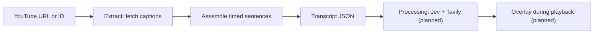

# Pila

A planned Chrome extension that checks YouTube captions for potential misinformation and shows evidence links during video playback.

The **Extract module is implemented as a TypeScript/Node.js CLI and library**. Extract and Process share the same server runtime and root package configuration. Process, Overlay, and the WXT extension integration are planned. Extract uses [`youtube-transcript-plus`](https://github.com/ericmmartin/youtube-transcript-plus) to retrieve existing YouTube captions; it does not transcribe audio or require Gemini credentials.

## Project layout

```text
extract/                  Caption extraction, JSON CLI, and its tests
  main.ts                 CLI entry point
  index.ts                Reusable Extract API
  tests/                  Offline tests and simulated YouTube responses
process/                  Process step (implementation planned)
shared/
  transcript.ts           Shared Transcript types and runtime validation
  transcript.schema.json  Portable JSON output contract
examples/                 Example videos and transcript fixtures
package.json              Shared dependencies and commands
tsconfig.json             Shared TypeScript configuration
```

Run commands from the repository root. Each step keeps its implementation in its own folder; shared contracts belong in `shared/`.

## Proof of concept

Extract retrieves the whole video's caption track and assembles caption fragments into timed sentence units. Processing will check those units and produce warnings for Overlay. All modules share the JSON `Transcript` contract below.



The planned extension stack is TypeScript + WXT (Manifest V3), with content scripts for playback, a background service worker for requests to the shared Extract/Process server, and Chrome messaging/storage. The caption package imports Node.js filesystem modules and runs on that server. Extension-to-server integration is still planned.

## 1. Extract

Requires **Node.js 22 or later**.

```bash
npm install

# Save the whole normalized transcript as JSON.
npm run extract -- 'https://www.youtube.com/watch?v=OwqIy8Ikv-c' --out transcript.json

# Run the Extract entry point directly.
npx tsx extract/main.ts zmfRG8-RHEI --out transcript.json

# Print JSON to stdout. --silent suppresses npm's own script banner.
npm run --silent extract -- OwqIy8Ikv-c
```

| Option | Description |
| --- | --- |
| `<video-url-or-id>` | Required. An 11-character ID or a YouTube `watch`, `youtu.be`, `shorts`, `embed`, or `live` URL. |
| `--lang`, `-l` | Exact caption language code, such as `en` or `zh-TW`; default `en`. |
| `--out`, `-o` | Write UTF-8 JSON to this file instead of stdout. Its parent directory must exist. |
| `--timeout` | Whole-request timeout in milliseconds; default `30000`. |
| `--help`, `-h` | Show usage. |

**JSON is the only output format.** There is no hardcoded video ID, `--format` option, API key, or 10-minute duration cap. A successful run emits one complete `Transcript`; errors go to stderr with a nonzero exit code. Caption retrieval and normalization finish before an output file is opened, so a fetch/normalization failure leaves an existing destination untouched.

### Library API

```typescript
import { extractTranscript, assertTranscript } from './extract';
import type { Transcript } from './shared/transcript';

async function main() {
  const transcript: Transcript = await extractTranscript('OwqIy8Ikv-c', {
    lang: 'en',
    timeoutMs: 30_000,
    // signal: controller.signal, // Optional caller cancellation.
  });
  assertTranscript(transcript);
  console.log(JSON.stringify(transcript, null, 2));
}

main().catch(console.error);
```

`extractTranscript()` rejects on failure. It accepts an optional third `CaptionFetcher` argument for offline tests or a replacement transport. `normalizeCaptions(videoId, captions, locale?)` is the pure assembly function for already downloaded captions.

### Output contract: Extract → Processing

The source of truth is [`shared/transcript.ts`](./shared/transcript.ts). A portable [JSON Schema](./shared/transcript.schema.json) describes the file structure; `assertTranscript()` additionally checks unique IDs, finite timestamps, chronological order, and `start < end`.

```typescript
export interface TranscriptSentence {
  id: string;       // Unique within this transcript, e.g. "s0001".
  text: string;     // Nonempty, plain Unicode caption text.
  start: number;    // Seconds from the start of the video, inclusive.
  end: number;      // Seconds from the start of the video, exclusive.
}

export interface Transcript {
  videoId: string;  // YouTube video ID, not the full URL.
  sentences: TranscriptSentence[]; // In nondecreasing start order.
}
```

A complete [JSON example](./examples/transcripts/extracted.json) was retrieved from `OwqIy8Ikv-c` using the CLI. It contains 36 sentence units. Shortened example (timings rounded here for readability):

```json
{
  "videoId": "OwqIy8Ikv-c",
  "sentences": [
    {
      "id": "s0001",
      "text": "I’m an atmospheric physicist.",
      "start": 2.42,
      "end": 8.559
    },
    {
      "id": "s0002",
      "text": "I’ve published more than 200 scientific papers.",
      "start": 2.42,
      "end": 8.559
    }
  ]
}
```

Extract owns this conversion:

- Native captions have `{ text, offset, duration, lang }`, with numeric timestamps in **seconds**. Extract keeps their timing precision and uses `offset + duration` for each cue's end.
- Captions are sorted by start time, preserving source order on ties. Whitespace and line breaks are normalized to spaces; empty caption text is omitted. Invalid timestamps fail extraction.
- `Intl.Segmenter` finds sentence boundaries in the combined text, including across caption boundaries. Each sentence gets the earliest start and latest end of all contributing captions. Sentences from the same caption can share or overlap time ranges; no word-level alignment is invented.
- IDs are assigned after assembly as `s0001`, `s0002`, and so on. Identical input and segmentation runtime produce identical IDs; sentence boundaries may change across runtime versions or caption updates. Processing and Overlay must preserve the IDs, text, and timestamps for that transcript.
- Sentence detection is a punctuation-based heuristic, not a grammatical guarantee. Abbreviations and automatic captions can produce imperfect boundaries. A final fragment is retained without adding punctuation; a passage with no sentence punctuation can remain one long unit.
- No network or parsing failure is converted into an empty success. The contract allows `sentences: []`, but the live extractor rejects empty/unusable caption tracks because it cannot establish that the video contains no speech.

### Existing raw caption files

Earlier prototype downloads contained a raw caption array. They are **not** the new `Transcript` handoff. To normalize that shape, call `normalizeCaptions(videoId, captions)` and serialize its return value.

For older `{ text, start, duration }[]` downloads, supply the video ID separately and map `start` to `offset`, adding `lang`, before calling the normalizer. Bilingual text is retained; line breaks alone do not separate sentences. Processing consumes the normalized `Transcript`, rather than raw cues.

### Limitations

- Videos need an accessible caption track in the requested language. Missing/disabled captions, an unavailable language, a removed video, HTTP 429, and timeouts are errors. There is no audio transcription fallback or automatic language fallback.
- The package uses YouTube's unofficial API. YouTube can block requests or change the endpoints, so availability can vary by video and network. Extract makes no automatic retries.
- Caption quality, punctuation, duplicate/rolling caption text, and coarse timing are inherited from YouTube. Extract normalizes boundaries and whitespace; it does not correct or deduplicate speech.
- The entire transcript is held in memory and returned once extraction succeeds. The 30-second request timeout applies regardless of video duration.

## 2. Processing (planned)

The implementation belongs in [`process/`](./process/README.md), alongside Extract on the same server. It imports its input contract from `shared/`.

For every sentence in the transcript:

1. **Detect with Jev:** ask whether the sentence contains misinformation. If no, continue with the next sentence. A yes is a candidate for further checking.
2. **Find and assess evidence:** use Tavily to search for evidence links, then ask Jev to assess the results and choose the best source supporting the conclusion that the statement is false. If a suitable source is found, emit a warning for Overlay. If no good evidence is found, skip the warning and continue.

**Input:** a `Transcript`. **Output:** `MisinformationWarning` results as checks complete; the warning contract is still to be implemented. A skipped sentence produces no warning; that does not establish that it is true.

## 3. Overlay (planned)

- Match warnings to sentences using the video ID and sentence ID.
- Use the sentence timestamps and current playback position to show the relevant warning. Shared/overlapping time ranges may make several sentences active at once.
- Tell the user **“This statement is probably false”** and display a clickable link to the selected source.

**Input:** the `Transcript`, warnings from Processing, and the current playback position. Only sentences with evidence from Processing produce a warning.

## Development

```bash
npm run typecheck
npm test
```

Tests run offline and cover sentence assembly, source timing validation, the runtime output contract, URL handling, cancellation, and CLI success/failure behavior with simulated YouTube responses. Live retrieval depends on YouTube and is checked separately.

## Example videos

See [example videos](./examples/youtube_videos.md).
