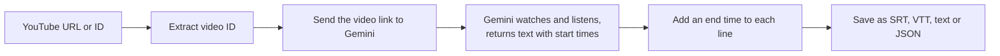
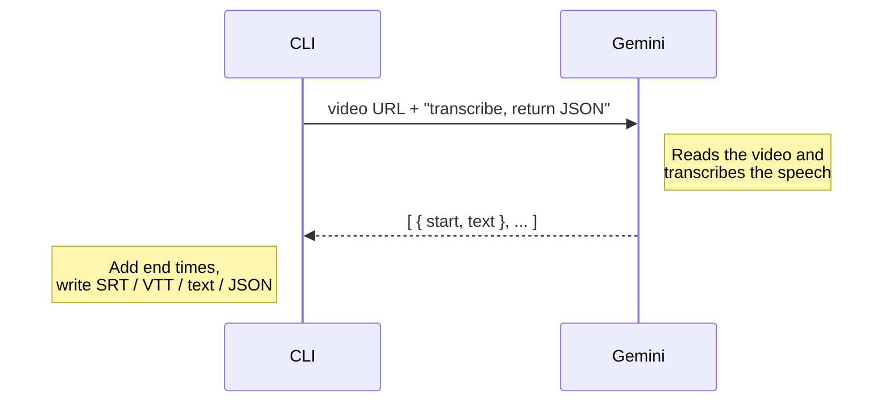
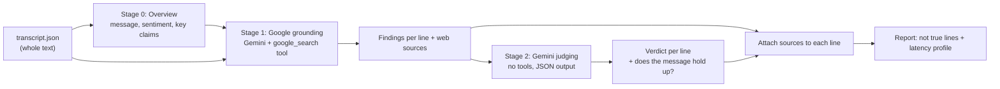
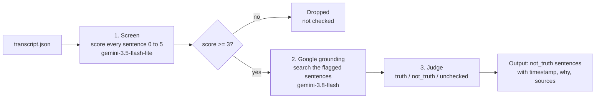

# Pila

A Chrome extension that captures YouTube subtitles in real time, even when closed captions (CC) are disabled, and sends each completed sentence to the **Jev API** to generate contextual questions during video playback.

## Tech Stack

- **TypeScript + WXT (Manifest V3)** — Chrome extension framework.
- **Content scripts + page-context bridge** — discover subtitles and monitor playback.
- **Background service worker + Fetch API** — retrieve captions and communicate with Jev.
- **Chrome messaging + storage** — internal communication and settings.

## Technical Considerations

Caption extraction relies on YouTube's undocumented interfaces and may not work for every video. Subtitle processing must handle playback synchronization, sentence assembly, and deduplication.

## Transcript CLI (Gemini only)

A standalone TypeScript CLI (`src/extract/`) that turns a single YouTube video into subtitles using **only Gemini**. There is no captions scraper, so it works the same whether or not the uploader enabled captions.

```bash
npm install
export GEMINI_API_KEY=your_key        # or put it in a .env file
npm run transcript -- <video-url-or-id> --format srt --out video.srt
```

| Option | Description |
| --- | --- |
| `--format srt\|vtt\|text\|json` | Output format (default `srt`) |
| `--out <file>` | Write to a file instead of stdout |

Env: `GEMINI_API_KEY` (required), `GEMINI_MODEL` (default `gemini-2.5-flash`).

### How it works



1. **Extract the ID.** Accepts a plain ID or a `watch`, `youtu.be`, `shorts`, `embed` or `live` link.
2. **Send the link to Gemini.** The video URL goes straight to the Gemini API. Nothing is downloaded.
3. **Gemini transcribes.** It processes the video's audio and returns a JSON list of `{ start, text }`.
4. **Add end times.** Gemini gives only start times, so each line ends where the next one starts (the last line gets 3 s).
5. **Write the file.** Cues are formatted as SRT or VTT, or saved as plain text or JSON.

### What Gemini does



The request asks for JSON with a fixed shape (`responseMimeType: application/json` plus a `responseSchema`), so the reply can be parsed directly with no text cleanup.

### Limits

- Only **public** YouTube videos can be passed by URL.
- Long videos can hit Gemini's length limits.
- Timestamps are generated by the model and can drift by a second or two.
- Every run is a billed Gemini call, and takes longer than reading existing captions.

Code: `src/extract/gemini.ts` (API call), `src/extract/transcript.ts` (ID parsing), `src/extract/format.ts` (SRT/VTT), `src/extract/index.ts` (CLI).

## Fact-check (`src/process/`)

Reads the **whole transcript** from the extract step and does two jobs: it works out **what the video is trying to deliver** (main message, sentiment, tone, key claims), and it checks the claims with **Google Search grounding**. The report returns only the lines found **not true**, each with its timestamp, why, and the sources. It runs on `gemini-3.8-flash` with thinking kept at its lowest level (`low`: 3.x models cannot turn it off; 2.5 models can).

```bash
npm run transcript -- <video-url> --format json --out transcript.json
npm run factcheck -- transcript.json --out factcheck.txt            # readable report
npm run factcheck -- transcript.json --format json --out factcheck.json
```

| Option | Description |
| --- | --- |
| `--format text\|json` | Text report (default), or the full JSON for every line |
| `--out <file>` | Write to a file instead of stdout |

The whole text goes into every call, so each line is judged in the context of the video. The report has three parts: what the video is trying to deliver and its sentiment, the not true lines, and whether the main message holds up.



| Verdict | Meaning |
| --- | --- |
| `truth` | Supported by grounding sources |
| `not_truth` | Contradicted by grounding sources, or shown to be false, misleading or outdated. The report lists these |
| `unchecked` | No checkable claim, or no grounding source either way. A `truth` or `not_truth` verdict with no source is downgraded to this, so it is never reported as a lie |

How sources get attached: Gemini returns `groundingChunks` (the web pages used) and `groundingSupports` (which span of its answer each page backs). Each support is matched to the stage 1 findings line it falls in, so every line lists its own sources. A verdict is only kept if grounding returned at least one source for that line.

The latency profile prints to stderr and is also saved in the JSON output, with the three stages timed separately. "Google grounding" is the full stage 1 call, so it includes the model writing the findings as well as the search. The API doesn't report search time on its own. Set `FACTCHECK_MODEL` to try a different model.

Limits: one pass over the whole text, so a transcript too long for the model's output limit fails with an error. Grounded search has its own quota and pricing. The source links are Google redirect URLs (the title is the site name). Sentiment and the message assessment are model judgements, and so are the verdicts, so treat the output as a first pass and check each flagged line yourself. Code: `src/process/factcheck.ts` (Gemini calls and parsing), `src/process/report.ts` (text report), `src/process/index.ts` (CLI).

## Screen and verify (`npm run check`)

One command that finds the sentences in a video that are **not true**. It first screens every sentence cheaply, then spends Google grounding only on the suspicious ones, and prints only the sentences found not true, each with its timestamp. The default threshold is **3**.

```bash
npm run transcript -- <video-url> --format json --out transcript.json
npm run check -- transcript.json --out result.txt                  # threshold 3
npm run check -- transcript.json --threshold 2 --format json --out result.json
```

| Option | Description |
| --- | --- |
| `--threshold <n>` | Suspicion score (0 to 5) at or above which a sentence is verified. Default `3` |
| `--format text\|json` | Only the not true sentences (default), or every flagged sentence with its verdict, counts and latency |
| `--out <file>` | Write to a file instead of stdout |

### Flow



1. **Screen.** One Gemini call reads the whole transcript and gives every sentence a suspicion score with a short explanation. It never decides what is true.
2. **Threshold.** Sentences scoring 3 or more are kept. The rest are dropped and never reach Google, which is what saves cost and time.
3. **Ground.** Google Search checks only the kept sentences, using the screener's note on why each looked suspicious.
4. **Judge.** A plain call turns the findings into `truth`, `not_truth` or `unchecked`. A verdict with no grounding source is downgraded to `unchecked`, so nothing is called untrue without a source.
5. **Report.** Only the `not_truth` sentences are printed, in time order.

### How the threshold works

The model assigns each sentence a score using this scale (set in the screening prompt in `src/process/screen.ts`). The threshold is just a cutoff on that score.

| Score | Meaning | At threshold 3 |
| --- | --- | --- |
| 0 to 0.9 | No factual claim, or a trivial well-known fact | skipped |
| 1 to 1.9 | Plausible, specific, nothing looks off | skipped |
| 2 to 2.9 | Surprising, one-sided, loaded, or overconfident | skipped |
| 3 to 3.9 | Likely wrong, exaggerated, misleading or outdated | **verified** |
| 4 to 5 | Clearly false, or a well-known myth | **verified** |

Why 3: it keeps only sentences the screener thinks are probably wrong, so grounding runs on a small share of the video. The trade-off is that a false sentence the screener scored 2.9 is never checked. Lower the threshold (`--threshold 2`) to catch more at the cost of more grounding calls, or raise it for fewer, more certain checks.

The scores are model judgements, not calibrated probabilities, so a 3 from one video is not exactly a 3 from another. Tune the threshold by looking at the `--format json` output, which lists every flagged sentence with its score.

Code: `src/process/screen.ts` (scoring), `src/process/check.ts` (screen, verify and report), `src/process/check-cli.ts` (CLI).

## Example videos

See [example_videos](./example_videos/README.md)
