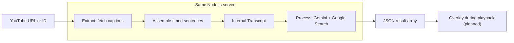

# Pila

A planned Chrome extension that checks YouTube captions for potential misinformation and shows evidence links during video playback.

The **Node.js API server runs Extract and Process together**. `POST /check` accepts a YouTube URL or ID, retrieves existing captions with [`youtube-transcript-plus`](https://github.com/ericmmartin/youtube-transcript-plus), then screens and verifies the transcript with Gemini and Google Search. It returns the top-level result array specified below. Overlay and the WXT extension integration are still planned.

Caption extraction does not transcribe audio or require an API key. Processing requires `GEMINI_API_KEY`. The merged backend uses the Gemini/Google Search implementation from `screen-verify`.

## Project layout

```text
extract/                  Caption extraction, JSON CLI, and its tests
  main.ts                 CLI entry point
  index.ts                Reusable Extract API
  tests/                  Offline tests and simulated YouTube responses
process/                  Gemini screening, grounded verification, CLIs, and tests
server/                   Shared HTTP server and endpoint tests
shared/
  transcript.ts           Shared Transcript types and runtime validation
  transcript.schema.json  Internal Extract → Process JSON contract
  overlay-results.ts      Server → Overlay types and runtime validation
  overlay-results.schema.json  Portable server → Overlay JSON contract
examples/                 Example videos and transcript fixtures
package.json              Shared dependencies and commands
tsconfig.json             Shared TypeScript configuration
```

Run commands from the repository root. Each step keeps its implementation in its own folder; shared contracts belong in `shared/`.

## Proof of concept

Extract retrieves the whole video's caption track and assembles caption fragments into timed sentence units. On the same server, Process checks those units and produces results for Overlay. The `Transcript` contract is the internal Extract → Process handoff; the server → Overlay response is a JSON array of results with `timestamp`, `sentence`, `score`, `explanation`, and `sources`.



The planned extension stack is TypeScript + WXT (Manifest V3), with content scripts for playback, a background service worker for requests to the shared Extract/Process server, and Chrome messaging/storage. The caption package imports Node.js filesystem modules and runs on that server. Extension-to-server integration is still planned.

## API: check a YouTube video

Requires **Node.js 22 or later**. Run from the repository root:

```bash
npm ci
cp .env.example .env
# Set GEMINI_API_KEY in .env, then start the server.
npm start
```

Submit a video URL (a bare 11-character video ID also works):

```bash
curl --fail-with-body http://127.0.0.1:3000/check \
  -H 'Content-Type: application/json' \
  -d '{"url":"https://www.youtube.com/watch?v=7wFWgopJP5Q","lang":"zh-TW"}'
```

`lang` is optional. When omitted, Extract prefers `en`, then the first regional English track (such as `en-US`), then the first available track if no English track exists. When supplied, it requests that exact language without translation or fallback. The request accepts only `url` and optional `lang`. Process writes `explanation` in the selected subtitle track's language, including its regional script and spelling. Caption text is preserved as supplied by YouTube.

The server runs caption extraction, suspicion screening, Google Search grounding for flagged sentences, then evidence-based judging. HTTP **200** contains the [server → Overlay result array](#output-contract-server--overlay), including `[]` when no sentences are reportable. `/check` keeps the transcript in memory and can be repeated regardless of files already saved by `/extract`.

Failures return a non-2xx response with `{ "error": { "code": "...", "message": "..." } }`. Invalid requests return 400, missing caption tracks return 422, upstream extraction or processing failures return 502, missing processing configuration returns 503, and timeouts return 504. Wrong content types return 415 and request bodies over 16 KiB return 413. Failures never become successful empty arrays.

The server listens on `127.0.0.1:3000`; set `PORT` to change the port. `GET /health` is a liveness check, not a check of external provider availability. Caption retrieval has a 30-second deadline. The complete check has a 180-second deadline shared across extraction and processing and is cancelled if the client disconnects. Root `.env` values are loaded by the server and Process CLIs; existing environment variables take precedence.

| Setting | Default | Purpose |
| --- | --- | --- |
| `GEMINI_API_KEY` | Required for `/check` | Server-side Gemini API credential. |
| `SCREEN_MODEL` | `gemini-3.5-flash-lite` | Screening model from `screen-verify`. |
| `FACTCHECK_MODEL` | `gemini-3.8-flash` | Grounding and judging model from `screen-verify`. |
| `PORT` | `3000` | Local server port. |
| `TRANSCRIPT_DIR` | `examples/transcripts` | Create-only output directory for `/extract`. |

Model IDs retain the branch defaults; your Gemini account must have access to the selected models and Google Search grounding. You can override the model IDs. Model availability and live provider behavior are separate from the offline tests.

## 1. Extract

Requires **Node.js 22 or later**.

### Send a video to the server

Run commands from the repository root:

```bash
npm install
npm start
```

In another terminal, submit a YouTube URL:

```bash
curl --fail-with-body http://127.0.0.1:3000/extract \
  -H 'Content-Type: application/json' \
  -d '{"url":"https://www.youtube.com/watch?v=7wFWgopJP5Q","lang":"zh-TW"}'
```

The server fetches the captions and writes `examples/transcripts/<videoId>.json` using the shared `Transcript` contract. The client receives HTTP **201** with `videoId`, the selected `language`, the saved `file` path, and `sentenceCount`. Only JSON is saved.

This is the **extraction-only endpoint**. Use `POST /check` for the complete Extract → Process → Overlay response.

`lang` is optional. When omitted, the server prefers English (`en`, then a regional English track), falling back to the first available track if English is absent; when supplied, it requests that exact language. Use `zh-TW` or `zh-Hant` for videos offering those Traditional Chinese tracks. No translation or script conversion is performed.

**Existing files are never replaced:** the server returns HTTP **409** before fetching if the destination exists, and exclusive file creation also prevents concurrent requests from replacing each other's output. Failed extraction creates no transcript. Clients cannot choose output paths.

The server listens on `127.0.0.1:3000`. Set `PORT` to change the port and `TRANSCRIPT_DIR` to change the server-owned output directory. `GET /health` checks liveness. The same server runs Process through `/check`.

### CLI

```bash
npm install

# Save the whole normalized transcript as JSON.
npm run extract -- 'https://www.youtube.com/watch?v=OwqIy8Ikv-c' --out transcript.json

# Run the Extract entry point directly.
npx tsx extract/main.ts zmfRG8-RHEI --out transcript.json

# Print JSON to stdout. --silent suppresses npm's own script banner.
npm run --silent extract -- OwqIy8Ikv-c
```

| Option | Description |
| --- | --- |
| `<video-url-or-id>` | Required. An 11-character ID or a YouTube `watch`, `youtu.be`, `shorts`, `embed`, or `live` URL. |
| `--lang`, `-l` | Exact caption language code, such as `en` or `zh-TW`; default `en`. |
| `--out`, `-o` | Create a UTF-8 JSON file instead of stdout. Its parent directory must exist; existing files are never replaced. |
| `--timeout` | Whole-request timeout in milliseconds; default `30000`. |
| `--help`, `-h` | Show usage. |

**JSON is the only output format.** There is no hardcoded video ID, `--format` option, API key, or 10-minute duration cap. A successful run emits one complete `Transcript`; errors go to stderr with a nonzero exit code. Caption retrieval and normalization finish before an output file is opened, so a fetch/normalization failure leaves an existing destination untouched.

### Library API

```typescript
import { extractTranscript, assertTranscript } from './extract';
import type { Transcript } from './shared/transcript';

async function main() {
  const transcript: Transcript = await extractTranscript('OwqIy8Ikv-c', {
    lang: 'en',
    timeoutMs: 30_000,
    // signal: controller.signal, // Optional caller cancellation.
  });
  assertTranscript(transcript);
  console.log(JSON.stringify(transcript, null, 2));
}

main().catch(console.error);
```

`extractTranscript()` rejects on failure. It accepts an optional third `CaptionFetcher` argument for offline tests or a replacement transport. `normalizeCaptions(videoId, captions, locale?)` is the pure assembly function for already downloaded captions.

### Internal output contract: Extract → Process

The source of truth is [`shared/transcript.ts`](./shared/transcript.ts). A portable [JSON Schema](./shared/transcript.schema.json) describes the file structure; `assertTranscript()` additionally checks unique IDs, finite timestamps, chronological order, and `start < end`.

```typescript
export interface TranscriptSentence {
  id: string;       // Unique within this transcript, e.g. "s0001".
  text: string;     // Nonempty, plain Unicode caption text.
  start: number;    // Seconds from the start of the video, inclusive.
  end: number;      // Seconds from the start of the video, exclusive.
}

export interface Transcript {
  videoId: string;  // YouTube video ID, not the full URL.
  sentences: TranscriptSentence[]; // In nondecreasing start order.
}
```

A complete [JSON example](./examples/transcripts/OwqIy8Ikv-c.json) was retrieved from `OwqIy8Ikv-c` using the CLI. It contains 36 sentence units. Shortened example (timings rounded here for readability):

```json
{
  "videoId": "OwqIy8Ikv-c",
  "sentences": [
    {
      "id": "s0001",
      "text": "I’m an atmospheric physicist.",
      "start": 2.42,
      "end": 8.559
    },
    {
      "id": "s0002",
      "text": "I’ve published more than 200 scientific papers.",
      "start": 2.42,
      "end": 8.559
    }
  ]
}
```

Extract owns this conversion:

- Native captions have `{ text, offset, duration, lang }`, with numeric timestamps in **seconds**. Extract keeps their timing precision and uses `offset + duration` for each cue's end.
- Captions are sorted by start time, preserving source order on ties. Whitespace and line breaks are normalized to spaces; empty caption text is omitted. Invalid timestamps fail extraction.
- `Intl.Segmenter` finds sentence boundaries in the combined text, including across caption boundaries. Each sentence gets the earliest start and latest end of all contributing captions. Sentences from the same caption can share or overlap time ranges; no word-level alignment is invented.
- IDs are assigned after assembly as `s0001`, `s0002`, and so on. Identical input and segmentation runtime produce identical IDs; sentence boundaries may change across runtime versions or caption updates. Process must retain the original sentence association internally and map `text` to `sentence` and `start` to `timestamp` in the Overlay response.
- Sentence detection is a punctuation-based heuristic, not a grammatical guarantee. Abbreviations and automatic captions can produce imperfect boundaries. A final fragment is retained without adding punctuation; a passage with no sentence punctuation can remain one long unit.
- No network or parsing failure is converted into an empty success. The contract allows `sentences: []`, but the live extractor rejects empty/unusable caption tracks because it cannot establish that the video contains no speech.

### Existing raw caption files

Earlier prototype downloads contained a raw caption array. They are **not** the new `Transcript` handoff. To normalize that shape, call `normalizeCaptions(videoId, captions)` and serialize its return value.

For older `{ text, start, duration }[]` downloads, supply the video ID separately and map `start` to `offset`, adding `lang`, before calling the normalizer. Bilingual text is retained; line breaks alone do not separate sentences. Processing consumes the normalized `Transcript`, rather than raw cues.

### Limitations

- Videos need an accessible caption track in the requested language. Missing/disabled captions, an unavailable language, a removed video, HTTP 429, and timeouts are errors. There is no audio transcription fallback. Automatic server selection prefers English, but an explicitly requested unavailable language remains an error.
- The package uses YouTube's unofficial API. YouTube can block requests or change the endpoints, so availability can vary by video and network. Extract makes no automatic retries.
- Caption quality, punctuation, duplicate/rolling caption text, and coarse timing are inherited from YouTube. Extract normalizes boundaries and whitespace; it does not correct or deduplicate speech.
- The entire transcript is held in memory and returned once extraction succeeds. The 30-second request timeout applies regardless of video duration.

## 2. Processing

The implementation lives in [`process/`](./process/README.md) and consumes the validated shared `Transcript` directly. It keeps the original video ID, sentence IDs, text, and timing throughout processing. It uses the same root package and server as Extract.

1. **Screen:** Gemini reads the full transcript and assigns every sentence a suspicion rating from 0 to 5. Sentences scoring strictly above 2 proceed to verification; skipped sentences produce no result and are not verified true.
2. **Ground:** Gemini with Google Search checks the flagged sentences using the full transcript as context. Sources are attached only where the provider's grounding metadata cites the findings for that sentence.
3. **Judge:** a separate Gemini call assesses the search findings. A conclusion without an attached HTTP(S) source remains inconclusive. The API returns the original screening rating, without rounding, only when verification finds a sourced problem. The rating measures suspicion on a 0–5 scale; it is not a calibrated probability of falsehood.

Incomplete, duplicate, malformed, blocked, or truncated screening/judging responses fail processing. No automatic retries or partial successful result arrays are returned. The full transcript is sent as context in each stage; videos that exceed the models' context or output limits fail rather than being silently truncated.

The branch's Process CLIs remain available and now accept the same `Transcript` JSON produced by Extract:

```bash
npm run extract -- OwqIy8Ikv-c --out transcript.json
npm run screen -- transcript.json --all
npm run check -- transcript.json --format json
npm run factcheck -- transcript.json --format json
```

`screen` only screens. `check` runs the server's screen-and-verify workflow and prints diagnostic results or a text report. `factcheck` retains the branch's separate whole-video overview and fact-check report. CLI diagnostic objects are separate from the HTTP Overlay array. See [`process/README.md`](./process/README.md) for library usage and CLI options.

### Output contract: server → Overlay

The shared output contract is implemented in [`shared/overlay-results.ts`](./shared/overlay-results.ts), with a portable [JSON Schema](./shared/overlay-results.schema.json). The completed server must return a **top-level JSON array** with this structure:

```json
[
  {
    "timestamp": 42.5,
    "sentence": "Sample excerpt from video speech or transcript",
    "score": 4.25,
    "explanation": "The cited evidence contradicts the claim.",
    "sources": ["https://factcheck.org/..."]
  }
]
```

| Field | Type | Meaning |
| --- | --- | --- |
| `timestamp` | `number` | Start time in seconds from the beginning of the video, taken from the original transcript sentence's `start`. |
| `sentence` | `string` | Original transcript sentence text, taken from `text`. |
| `score` | `number` | Original suspicion rating on a 0–5 scale, strictly greater than 2; fractional values are retained. |
| `explanation` | `string` | Evidence-based reason from the verifier, written in the selected subtitle track's language. |
| `sources` | `string[]` | At least one HTTP(S) source URL cited for this sentence. |

Each result has exactly these five fields. `explanation` is the verifier's evidence-based reason, not the screening rationale. The response has no wrapper object, and Overlay does not need the internal `Transcript`, sentence IDs, or server file paths. The client associates the response with the video it requested and uses `timestamp` for playback. Return results in nondecreasing timestamp order. A successful check with no reportable results returns `[]`; extraction or processing failures must remain errors.

`OverlayResult` and `OverlayResults` provide the TypeScript types. `assertOverlayResults()` validates the exact fields, finite nonnegative timestamps, nonempty sentence text, finite scores strictly above 2 and at most 5, nonempty explanations, at least one HTTP(S) source URL, and chronological order. Supported and inconclusive claims, and screening ratings of 2 or less, are omitted.

The server validates this contract before replying and checks that every result matches an original transcript sentence and start time. Internal diagnostics, sentence IDs, model metadata, and server file paths are omitted from the HTTP response.

## 3. Overlay (planned)

- Associate the returned array with the requested video.
- Use each result's `timestamp` and the current playback position to show the relevant result. Multiple results can share a timestamp.
- Display the `sentence`, its `score`, and clickable `sources`. Show the evidence-based `explanation` beside the original suspicion rating.

**Input:** the server's result array and the current playback position. Each result from Process provides an Overlay item.

## Development

```bash
npm run typecheck
npm test
```

Tests run offline and cover extraction, both shared contracts, strict model-response parsing, source attribution (including Chinese byte offsets), cancellation, CLI behavior, and local HTTP integration. Caption and Gemini providers are simulated. Existing-file and concurrent-write protection for `/extract` remain covered. Live YouTube retrieval and billed Gemini/Google Search calls require separate verification with working provider access.

## Example videos

See [example videos](./examples/youtube_videos.md). The branch's [legacy raw captions](./examples/screen-verify-captions.json) are retained for reference; normalize raw cues with Extract before passing them to Process.
