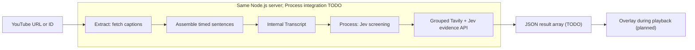

# Pila

A planned Chrome extension that checks YouTube captions for potential misinformation and shows evidence links during video playback.

The **Extract module is implemented as a TypeScript/Node.js HTTP endpoint, CLI, and library**. Extract and Process share the root package configuration and must run on the **same Node.js server**. Process includes a working Jev screening CLI and an exported Tavily/Jev evidence-checking function. HTTP integration, final Overlay reporting, and the WXT extension integration remain planned. The completed server will extract captions, process them, and return the result array specified below to Overlay. Extract uses [`youtube-transcript-plus`](https://github.com/ericmmartin/youtube-transcript-plus) to retrieve existing YouTube captions; it does not transcribe audio or require Gemini credentials.

## Project layout

```text
extract/                  Caption extraction, JSON CLI, and its tests
  main.ts                 CLI entry point
  index.ts                Reusable Extract API
  tests/                  Offline tests and simulated YouTube responses
process/                  Jev preprocessing and screening CLI
server/                   Shared HTTP server and endpoint tests
shared/
  transcript.ts           Shared Transcript types and runtime validation
  transcript.schema.json  Internal Extract → Process JSON contract
  overlay-results.ts      Server → Overlay types and validation (TODO)
  overlay-results.schema.json  Portable server → Overlay contract (TODO)
examples/                 Example videos and transcript fixtures
package.json              Shared dependencies and commands
tsconfig.json             Shared TypeScript configuration
```

Run commands from the repository root. Each step keeps its implementation in its own folder; shared contracts belong in `shared/`.

## Proof of concept

Extract retrieves the whole video's caption track and assembles caption fragments into timed sentence units. On the same server, Process will check those units and produce results for Overlay. The `Transcript` contract is the internal Extract → Process handoff; the server → Overlay response is a JSON array of results with `timestamp`, `sentence`, `score`, and `sources`.



The planned extension stack is TypeScript + WXT (Manifest V3), with content scripts for playback, a background service worker for requests to the shared Extract/Process server, and Chrome messaging/storage. The caption package imports Node.js filesystem modules and runs on that server. Extension-to-server integration is still planned.

## 1. Extract

Requires **Node.js 22 or later**.

### Send a video to the server

Run commands from the repository root:

```bash
npm install
npm start
```

In another terminal, submit a YouTube URL:

```bash
curl --fail-with-body http://127.0.0.1:3000/extract \
  -H 'Content-Type: application/json' \
  -d '{"url":"https://www.youtube.com/watch?v=7wFWgopJP5Q","lang":"zh-TW"}'
```

The server fetches the captions and writes `examples/transcripts/<videoId>.json` using the shared `Transcript` contract. The client receives HTTP **201** with `videoId`, the selected `language`, the saved `file` path, and `sentenceCount`. Only JSON is saved.

This is the **current extraction-only endpoint**. It does not run Process or return the [server → Overlay response](#output-contract-server--overlay). The output shape is documented; its shared validator, Process integration, and returning that array are still TODO.

`lang` is optional. When omitted, the server uses YouTube's first available caption track; when supplied, it requests that exact language. Use `zh-TW` or `zh-Hant` for videos offering those Traditional Chinese tracks. No translation or script conversion is performed.

**Existing files are never replaced:** the server returns HTTP **409** before fetching if the destination exists, and exclusive file creation also prevents concurrent requests from replacing each other's output. Failed extraction creates no transcript. Clients cannot choose output paths.

The server listens on `127.0.0.1:3000`. Set `PORT` to change the port and `TRANSCRIPT_DIR` to change the server-owned output directory. `GET /health` checks readiness. Process will be integrated into this same server.

### CLI

```bash
npm install

# Save the whole normalized transcript as JSON.
npm run extract -- 'https://www.youtube.com/watch?v=OwqIy8Ikv-c' --out transcript.json

# Run the Extract entry point directly.
npx tsx extract/main.ts zmfRG8-RHEI --out transcript.json

# Print JSON to stdout. --silent suppresses npm's own script banner.
npm run --silent extract -- OwqIy8Ikv-c
```

| Option | Description |
| --- | --- |
| `<video-url-or-id>` | Required. An 11-character ID or a YouTube `watch`, `youtu.be`, `shorts`, `embed`, or `live` URL. |
| `--lang`, `-l` | Exact caption language code, such as `en` or `zh-TW`; default `en`. |
| `--out`, `-o` | Create a UTF-8 JSON file instead of stdout. Its parent directory must exist; existing files are never replaced. |
| `--timeout` | Whole-request timeout in milliseconds; default `30000`. |
| `--help`, `-h` | Show usage. |

**JSON is the only output format.** There is no hardcoded video ID, `--format` option, API key, or 10-minute duration cap. A successful run emits one complete `Transcript`; errors go to stderr with a nonzero exit code. Caption retrieval and normalization finish before an output file is opened, so a fetch/normalization failure leaves an existing destination untouched.

### Library API

```typescript
import { extractTranscript, assertTranscript } from './extract';
import type { Transcript } from './shared/transcript';

async function main() {
  const transcript: Transcript = await extractTranscript('OwqIy8Ikv-c', {
    lang: 'en',
    timeoutMs: 30_000,
    // signal: controller.signal, // Optional caller cancellation.
  });
  assertTranscript(transcript);
  console.log(JSON.stringify(transcript, null, 2));
}

main().catch(console.error);
```

`extractTranscript()` rejects on failure. It accepts an optional third `CaptionFetcher` argument for offline tests or a replacement transport. `normalizeCaptions(videoId, captions, locale?)` is the pure assembly function for already downloaded captions.

### Internal output contract: Extract → Process

The source of truth is [`shared/transcript.ts`](./shared/transcript.ts). A portable [JSON Schema](./shared/transcript.schema.json) describes the file structure; `assertTranscript()` additionally checks unique IDs, finite timestamps, chronological order, and `start < end`.

```typescript
export interface TranscriptSentence {
  id: string;       // Unique within this transcript, e.g. "s0001".
  text: string;     // Nonempty, plain Unicode caption text.
  start: number;    // Seconds from the start of the video, inclusive.
  end: number;      // Seconds from the start of the video, exclusive.
}

export interface Transcript {
  videoId: string;  // YouTube video ID, not the full URL.
  sentences: TranscriptSentence[]; // In nondecreasing start order.
}
```

A complete [JSON example](./examples/transcripts/OwqIy8Ikv-c.json) was retrieved from `OwqIy8Ikv-c` using the CLI. It contains 36 sentence units. Shortened example (timings rounded here for readability):

```json
{
  "videoId": "OwqIy8Ikv-c",
  "sentences": [
    {
      "id": "s0001",
      "text": "I’m an atmospheric physicist.",
      "start": 2.42,
      "end": 8.559
    },
    {
      "id": "s0002",
      "text": "I’ve published more than 200 scientific papers.",
      "start": 2.42,
      "end": 8.559
    }
  ]
}
```

Extract owns this conversion:

- Native captions have `{ text, offset, duration, lang }`, with numeric timestamps in **seconds**. Extract keeps their timing precision and uses `offset + duration` for each cue's end.
- Captions are sorted by start time, preserving source order on ties. Whitespace and line breaks are normalized to spaces; empty caption text is omitted. Invalid timestamps fail extraction.
- `Intl.Segmenter` finds sentence boundaries in the combined text, including across caption boundaries. Each sentence gets the earliest start and latest end of all contributing captions. Sentences from the same caption can share or overlap time ranges; no word-level alignment is invented.
- IDs are assigned after assembly as `s0001`, `s0002`, and so on. Identical input and segmentation runtime produce identical IDs; sentence boundaries may change across runtime versions or caption updates. Process must retain the original sentence association internally and map `text` to `sentence` and `start` to `timestamp` in the Overlay response.
- Sentence detection is a punctuation-based heuristic, not a grammatical guarantee. Abbreviations and automatic captions can produce imperfect boundaries. A final fragment is retained without adding punctuation; a passage with no sentence punctuation can remain one long unit.
- No network or parsing failure is converted into an empty success. The contract allows `sentences: []`, but the live extractor rejects empty/unusable caption tracks because it cannot establish that the video contains no speech.

### Existing raw caption files

Earlier prototype downloads contained a raw caption array. They are **not** the new `Transcript` handoff. To normalize that shape, call `normalizeCaptions(videoId, captions)` and serialize its return value.

For older `{ text, start, duration }[]` downloads, supply the video ID separately and map `start` to `offset`, adding `lang`, before calling the normalizer. Bilingual text is retained; line breaks alone do not separate sentences. Processing consumes the normalized `Transcript`, rather than raw cues.

### Limitations

- Videos need an accessible caption track in the requested language. Missing/disabled captions, an unavailable language, a removed video, HTTP 429, and timeouts are errors. There is no audio transcription fallback or automatic language fallback.
- The package uses YouTube's unofficial API. YouTube can block requests or change the endpoints, so availability can vary by video and network. Extract makes no automatic retries.
- Caption quality, punctuation, duplicate/rolling caption text, and coarse timing are inherited from YouTube. Extract normalizes boundaries and whitespace; it does not correct or deduplicate speech.
- The entire transcript is held in memory and returned once extraction succeeds. The 30-second request timeout applies regardless of video duration.

## 2. Processing

[`process/`](./process/README.md) runs alongside Extract and consumes the shared `Transcript` contract. Its screening CLI automatically selects English or Traditional Chinese prompts and batches target sentences with surrounding context. Oversized Chinese entries are split into smaller targets while retaining their source IDs and original time ranges. Jev rates each target independently and saves ranked concerns.

The planned server integration will run Extract and then Process before returning the result array to the client; the extension will not orchestrate these steps separately. The screening CLI's saved scores are internal review candidates, not the evidence-backed Overlay response.

```bash
# Prepare only
npm run preprocess -- examples/transcripts/OwqIy8Ikv-c.json

# Screen with Jev (requires API credentials)
npm run jev -- examples/transcripts/OwqIy8Ikv-c.json

# Chinese transcripts select zh-TW prompts automatically
npm run jev -- examples/transcripts/7wFWgopJP5Q.json
```

See [JEV.md](./JEV.md) for JSON prompts, score criteria, options, API reuse, and the `results/` layout. The module also exports callable functions; a server handler need not spawn the CLI. Internal fractional screening scores prioritize review and are not the final integer Overlay scores.

The complete processing pipeline is:

1. **Screen with Jev (implemented):** identify statements that need fact-checking. A candidate proceeds to evidence checking; otherwise, continue with the next sentence.
2. **Find and assess evidence (function API implemented):** call `verifySuspicions()` from `process/tavily.ts`. Related candidates share bounded Tavily searches, then Jev assesses each target against retrieved excerpts independently. Outcomes include contradiction, support, conflicts, and insufficient evidence, with actual source URLs and excerpts. Final integer Overlay scores and endpoint integration remain TODO.

**Input:** the internal `Transcript`. **Output:** the array defined below. A skipped sentence produces no result; that does not establish that it is true.

### Output contract: server → Overlay

The completed server must return a **top-level JSON array** with the structure below. Shared types, schema, and runtime validation are planned for `shared/overlay-results.ts` and `shared/overlay-results.schema.json`; those files are not yet present.

```json
[
  {
    "timestamp": 42.5,
    "sentence": "Sample excerpt from video speech or transcript",
    "score": 2,
    "sources": ["https://factcheck.org/..."]
  }
]
```

| Field | Type | Meaning |
| --- | --- | --- |
| `timestamp` | `number` | Start time in seconds from the beginning of the video, taken from the original transcript sentence's `start`. |
| `sentence` | `string` | Original transcript sentence text, taken from `text`. |
| `score` | `0 \| 1 \| 2 \| 3` | Integer score. Its meaning and scoring criteria will be specified later. |
| `sources` | `string[]` | HTTP(S) source URLs associated with the result. |

Each result has exactly these four fields; `explanation` is no longer part of the contract. The response has no wrapper object, and Overlay does not need the internal `Transcript`, sentence IDs, or server file paths. The client associates the response with the video it requested and uses `timestamp` for playback. Return results in nondecreasing timestamp order. A successful check with no reportable results returns `[]`; extraction or processing failures must remain errors.

The planned `OverlayResult`, `OverlayResults`, and `assertOverlayResults()` must enforce the exact fields, finite nonnegative timestamps, nonempty sentence text, integer scores from 0 through 3, HTTP(S) source URLs, and chronological order. The contract permits an empty `sources` array and does not assign score meanings.

**Process TODO:** implement the shared result types/schema/validator and their tests; define final scoring criteria and map the existing screening/evidence outputs to the Overlay fields; and integrate Process into the server with integration tests. Split targets must map back to their original source sentence text and start time. The screening implementation exists; the final response and combined endpoint remain pending.

## 3. Overlay (planned)

- Associate the returned array with the requested video.
- Use each result's `timestamp` and the current playback position to show the relevant result. Multiple results can share a timestamp.
- Display the `sentence`, its `score`, and clickable `sources`. Score interpretation will be specified with the scoring criteria.

**Input:** the server's result array and the current playback position. Each result from Process provides an Overlay item.

## Development

```bash
npm run typecheck
npm test
```

Existing tests run offline and cover sentence assembly, source timing validation, the internal transcript contract, URL handling, cancellation, CLI behavior, and HTTP requests to a local test server with simulated caption providers. Server → Overlay contract tests are still TODO. They verify that existing files and concurrent requests cannot overwrite transcripts. Live retrieval depends on YouTube and is checked separately.

## Example videos

See [example videos](./examples/youtube_videos.md).
