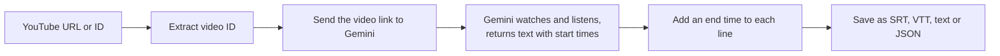
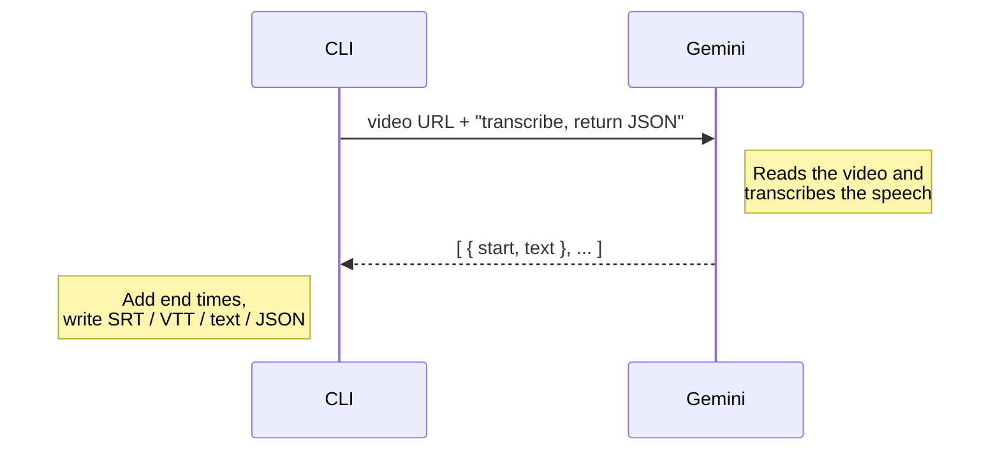

# Pila

A Chrome extension that checks YouTube subtitles for potential misinformation and shows evidence links during video playback.

## Tech Stack

- **TypeScript + WXT (Manifest V3)** — Chrome extension framework.
- **Content scripts + page-context bridge** — discover subtitles and monitor playback.
- **Background service worker + Fetch API** — retrieve captions and communicate with Jev.
- **Chrome messaging + storage** — internal communication and settings.


## Proof of Concept

The POC will fetch the **whole transcript when a user opens a YouTube video**. Ingestion assembles subtitle fragments into complete sentences. All three modules run in the **TypeScript extension**, with Jev and Tavily requests handled by the background service worker.

This is the planned architecture. The modules can be built in parallel using the shared data contracts below and mock inputs and outputs.

### Limitations

Because of potential long transcription time, we limit ourselves to videos of at most 10 minutes.

## Modules

### 1. Ingestion

A standalone TypeScript CLI (`src/`) that turns a single YouTube video into subtitles using Gemini. There is no captions scraper, so it works the same whether or not the uploader enabled captions.

```bash
npm install
export GEMINI_API_KEY=your_key        # or put it in a .env file
npm run transcript -- <video-url-or-id> --format srt --out video.srt
```
It goes to
| Option | Description |
| --- | --- |
| `--format srt\|vtt\|text\|json` | Output format (default `srt`) |
| `--out <file>` | Write to a file instead of stdout |

Env: `GEMINI_API_KEY` (required), `GEMINI_MODEL` (default `gemini-2.5-flash`).

#### How it works



1. **Extract the ID.** Accepts a plain ID or a `watch`, `youtu.be`, `shorts`, `embed` or `live` link.
2. **Send the link to Gemini.** The video URL goes straight to the Gemini API. Nothing is downloaded.
3. **Gemini transcribes.** It processes the video's audio and returns a JSON list of `{ start, text }`.
4. **Add end times.** Gemini gives only start times, so each line ends where the next one starts (the last line gets 3 s).
5. **Write the file.** Cues are formatted as SRT or VTT, or saved as plain text or JSON.

#### What Gemini does



The request asks for JSON with a fixed shape (`responseMimeType: application/json` plus a `responseSchema`), so the reply can be parsed directly with no text cleanup.

#### Transcriber output → Processing input

**Handoff format: one JSON `Transcript` for the whole video, containing complete, timed sentences.** Use `--format json` for this handoff; SRT, VTT and plain text are export formats. The types below define the implementation target for parallel development. The transcriber implementation is not yet checked into this repository, so its runtime output has not been verified against this contract.

```typescript
export interface TranscriptSentence {
  id: string;       // Unique within this transcript, e.g. "s0001".
  text: string;     // Complete sentence, as plain Unicode text.
  start: number;    // Seconds from the start of the video, inclusive.
  end: number;      // Seconds from the start of the video, exclusive.
}

export interface Transcript {
  videoId: string;  // YouTube video ID, not the full URL.
  sentences: TranscriptSentence[]; // In playback order.
}
```

Example handoff (a shortened mock, with approximate timings):

```json
{
  "videoId": "OwqIy8Ikv-c",
  "sentences": [
    {
      "id": "s0001",
      "text": "I’m an atmospheric physicist.",
      "start": 2.52,
      "end": 4.41
    },
    {
      "id": "s0002",
      "text": "I’ve published more than 200 scientific papers.",
      "start": 4.41,
      "end": 7.88
    }
  ]
}
```

The transcriber owns the conversion from subtitle cues to this handoff:

- Gemini's raw result is an array of `{ start, text }`. Add each cue's `end` from the next cue's `start`; the last cue ends at its own `start + 3`. These are estimated subtitle timings, not word-level alignments.
- Assemble fragments into complete sentences before handing them to Processing. A sentence spanning several cues starts at the first contributing cue's `start` and ends at the last contributing cue's `end`. If a cue contains several sentences and finer timings are unavailable, those sentences may share its time range.
- Assign sentence IDs after assembly. Keep the IDs, text and timestamps unchanged while Processing and Overlay use that transcript. IDs are scoped to this transcript; a new transcription may assign different IDs.
- Emit sentences in nondecreasing `start` order, with nonempty text and finite timestamps satisfying `0 <= start < end`. All timestamps are numeric **seconds**, including fractions, not milliseconds or formatted time strings.
- Deliver the whole transcript once transcription and sentence assembly succeed. A successful transcription with no speech has `sentences: []`; a transcription failure must be reported separately rather than passed off as an empty transcript.

The existing [sample transcript](./examples/transcripts/transcript.json) is **raw cue data**, not this sentence-level `Transcript`. Its shape is:

```typescript
type SampleCue = { text: string; start: number; duration: number };
// The file contains SampleCue[]. Both start and duration are in seconds.
```

To use that fixture, supply the video ID separately, calculate each cue's `end = start + duration`, then assemble sentences and assign IDs as above. Its text includes Chinese and English separated by `\n`; a line break alone does not mark a new sentence. Processing should consume the normalized `Transcript`, rather than parse subtitle files or infer sentences from raw cues.

### 2. Processing

For every sentence in the transcript:

1. **Detect with Jev:** ask whether the sentence contains misinformation. If no, continue with the next sentence. A yes is a candidate for further checking.
2. **Find and assess evidence:** use Tavily to search for a list of evidence links, then ask Jev to assess the results and choose the best source supporting the conclusion that the statement is false. If a suitable source is found, emit a warning for Overlay. If no good evidence is found, skip the warning and continue with the next sentence.

**Input:** a `Transcript`. **Output:** `MisinformationWarning` results as checks complete. A skipped sentence produces no warning; that does not establish that it is true.

### 3. Overlay

- Match warnings to sentences using the video ID and sentence ID.
- Use the sentence timestamps and current playback position to show the relevant warning.
- Tell the user **“This statement is probably false”** and display a clickable link to the selected source for more information.

**Input:** the `Transcript`, warnings from Processing, and the current playback position. Only sentences with evidence from Processing produce a warning.

## Example videos

See [example_videos](./example_videos/README.md)
