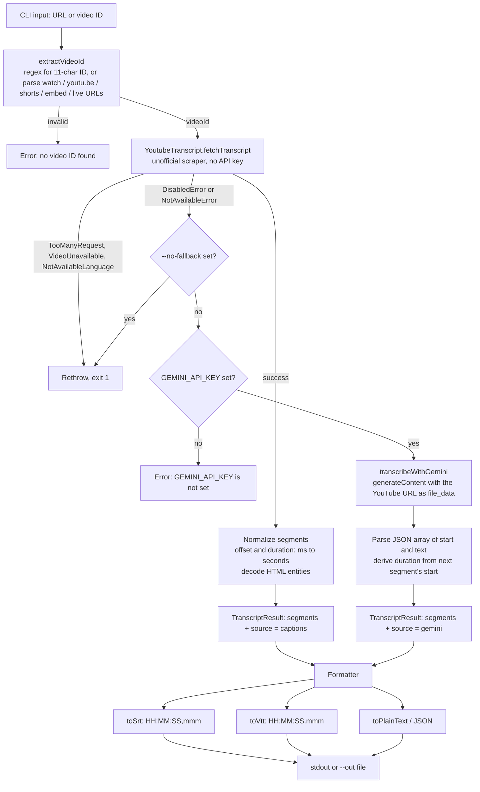
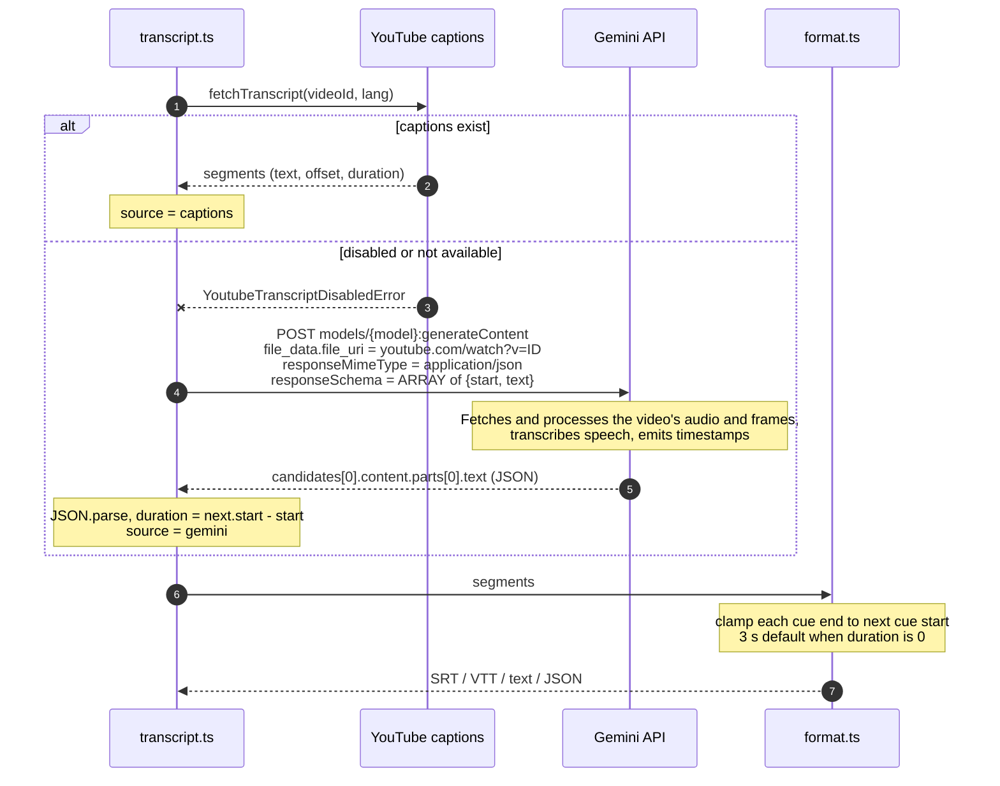

# Pila

A Chrome extension that captures YouTube subtitles in real time, even when closed captions (CC) are disabled, and sends each completed sentence to the **Jev API** to generate contextual questions during video playback.

## Tech Stack

- **TypeScript + WXT (Manifest V3)** — Chrome extension framework.
- **Content scripts + page-context bridge** — discover subtitles and monitor playback.
- **Background service worker + Fetch API** — retrieve captions and communicate with Jev.
- **Chrome messaging + storage** — internal communication and settings.

## Technical Considerations

Caption extraction relies on YouTube's undocumented interfaces and may not work for every video. Subtitle processing must handle playback synchronization, sentence assembly, and deduplication.

## Transcript CLI

A standalone TypeScript CLI (`src/`) that fetches the transcript of a single YouTube video and outputs it as SRT, VTT, plain text or JSON. It uses YouTube's own captions when they exist and falls back to **Gemini** when the uploader disabled them.

```bash
npm install
export GEMINI_API_KEY=your_key        # or put it in a .env file
npm run transcript -- <video-url-or-id> --format srt --out video.srt
```

| Option | Description |
| --- | --- |
| `--format srt\|vtt\|text\|json` | Output format (default `srt`) |
| `--out <file>` | Write to a file instead of stdout |
| `--lang <code>` | Preferred caption language |
| `--no-fallback` | Fail instead of calling Gemini when captions are unavailable |

Env: `GEMINI_API_KEY` (required for the fallback), `GEMINI_MODEL` (default `gemini-2.5-flash`).

### Flow



### How Gemini helps

When captions are disabled there is no text track to scrape, so the CLI has nothing to read. Gemini is multimodal and can ingest a public YouTube video by URL, which means it does the speech recognition itself and no audio download (`yt-dlp`) or separate speech-to-text service is needed.



Key details:

- **Structured output:** `responseMimeType: application/json` plus a `responseSchema` forces a parseable array of `{ start, text }`, so there is no free-text parsing.
- **Same data shape:** both paths return `TranscriptSegment[]` (`text`, `start`, `duration` in seconds). The `source` field (`captions` or `gemini`) records which one produced it.
- **Limits:** only public videos work. Long videos can hit token or length limits. Gemini timestamps are model-generated and can drift by a second or two, and it gives only start times, so durations are derived from the next segment (the last cue defaults to 3 s). Each fallback call counts against Gemini API usage.
- **Code:** `src/transcript.ts` (routing and fallback), `src/gemini.ts` (API call), `src/format.ts` (SRT/VTT), `src/index.ts` (CLI).

## Example videos

See [example_videos](./example_videos/README.md)
