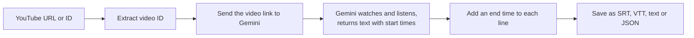
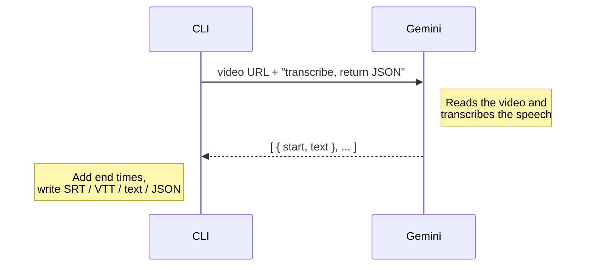

# Pila

A Chrome extension that captures YouTube subtitles in real time, even when closed captions (CC) are disabled, and sends each completed sentence to the **Jev API** to generate contextual questions during video playback.

## Tech Stack

- **TypeScript + WXT (Manifest V3)** — Chrome extension framework.
- **Content scripts + page-context bridge** — discover subtitles and monitor playback.
- **Background service worker + Fetch API** — retrieve captions and communicate with Jev.
- **Chrome messaging + storage** — internal communication and settings.

## Technical Considerations

Caption extraction relies on YouTube's undocumented interfaces and may not work for every video. Subtitle processing must handle playback synchronization, sentence assembly, and deduplication.

## Transcript CLI (Gemini only)

A standalone TypeScript CLI (`src/`) that turns a single YouTube video into subtitles using **only Gemini**. There is no captions scraper, so it works the same whether or not the uploader enabled captions.

```bash
npm install
export GEMINI_API_KEY=your_key        # or put it in a .env file
npm run transcript -- <video-url-or-id> --format srt --out video.srt
```

| Option | Description |
| --- | --- |
| `--format srt\|vtt\|text\|json` | Output format (default `srt`) |
| `--out <file>` | Write to a file instead of stdout |

Env: `GEMINI_API_KEY` (required), `GEMINI_MODEL` (default `gemini-2.5-flash`).

### How it works



1. **Extract the ID.** Accepts a plain ID or a `watch`, `youtu.be`, `shorts`, `embed` or `live` link.
2. **Send the link to Gemini.** The video URL goes straight to the Gemini API. Nothing is downloaded.
3. **Gemini transcribes.** It processes the video's audio and returns a JSON list of `{ start, text }`.
4. **Add end times.** Gemini gives only start times, so each line ends where the next one starts (the last line gets 3 s).
5. **Write the file.** Cues are formatted as SRT or VTT, or saved as plain text or JSON.

### What Gemini does



The request asks for JSON with a fixed shape (`responseMimeType: application/json` plus a `responseSchema`), so the reply can be parsed directly with no text cleanup.

### Limits

- Only **public** YouTube videos can be passed by URL.
- Long videos can hit Gemini's length limits.
- Timestamps are generated by the model and can drift by a second or two.
- Every run is a billed Gemini call, and takes longer than reading existing captions.

Code: `src/gemini.ts` (API call), `src/transcript.ts` (ID parsing), `src/format.ts` (SRT/VTT), `src/index.ts` (CLI).

## Example videos

See [example_videos](./example_videos/README.md)
