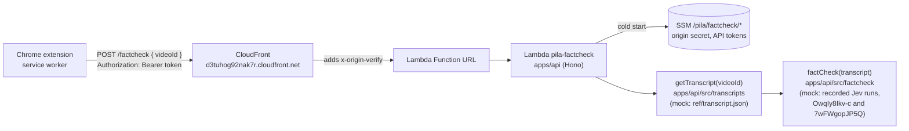
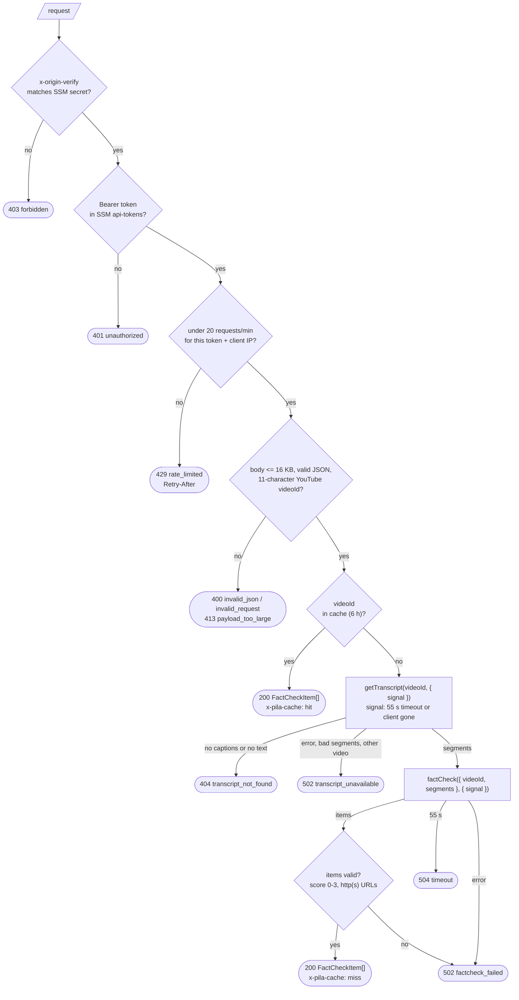
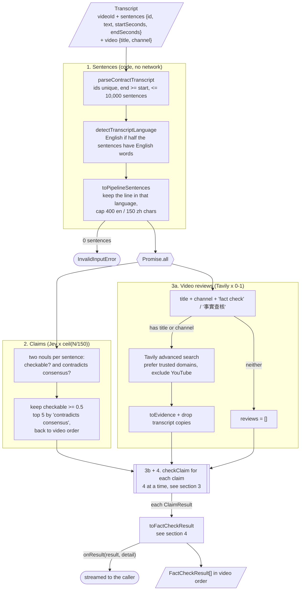
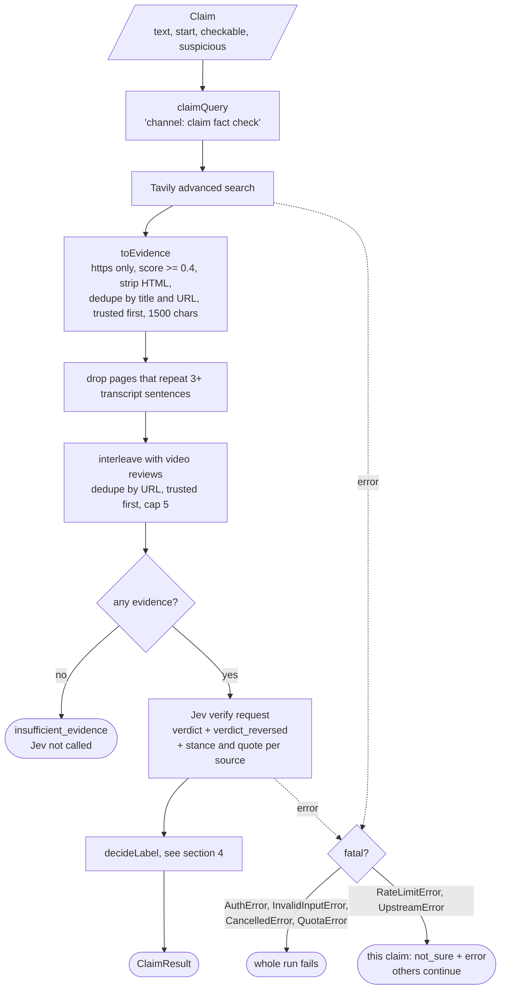
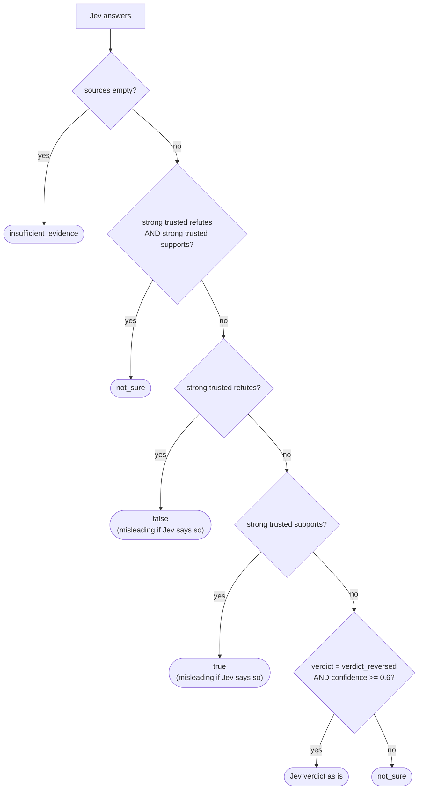
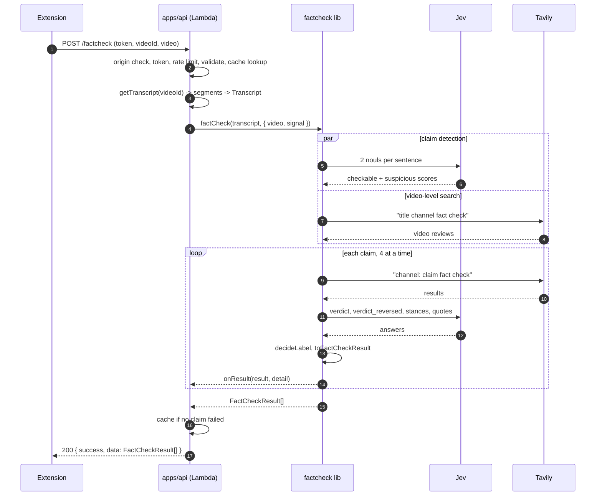

# Workflow: from the extension to a verdict

> **Removed 2026-10-17:** after the demo, the AWS stack (CloudFront, Lambda, IAM role, SSM parameters, logs, ECR) was
> deleted. The URLs below no longer work; they are kept as a record. To bring it back, follow `infra/aws/README.md`
> (recreate the resources, then build and deploy `apps/api`).

Matches the code as of 2026-10-17.

> **Change (2026-10-17):** the hosted API (`apps/api`) no longer runs this library. It chains a teammate's
> transcript function and a teammate's fact-check function, and returns `FactCheckItem[]`
> (`{ timestamp, sentence, score: 0-3, sources: string[] }`). Both are mocks for now. Sections 0-1 describe the API;
> sections 2-6 describe this library (`packages/factcheck`), kept as a reference implementation.

Diagrams are Mermaid. They render on GitHub and in the IntelliJ Markdown preview.

## 0. System

The extension sends a YouTube video ID to our API; the API loads the transcript, then fact-checks it.



Limits: CloudFront and Lambda cut requests at 60 s, so a run is aborted at 55 s. Lambda reserved
concurrency is 5. Deployment details: [`infra/aws/README.md`](../../../infra/aws/README.md).

## 1. API request: `POST /factcheck`



```text
POST /factcheck
Authorization: Bearer <token>
Content-Type: application/json

{ "videoId": "OwqIy8Ikv-c" }

200 [ { "timestamp": 104.71, "sentence": "...", "score": 3, "sources": ["https://..."] } ]
4xx/5xx { "error": { "code", "message", "requestId" } }
```

`GET /health` returns `{ ok: true }` (origin check only, no token). Contracts and how to plug in the real
functions: [`apps/api/README.md`](../../../apps/api/README.md).

The cache and rate limit are in memory, per Lambda container (up to 5), so limits are about 5x
looser than configured. Fine for the POC.

## 2. Library: `factCheck` pipeline



Why two detection questions: Jev can't verify facts, but in a live test on the Lindzen video,
ranking checkable sentences by "contradicts consensus" put the claims Science Feedback reviewed
first, and dropped "I've published more than 200 papers" to the bottom. Real claims scored as low
as 0.53 on "checkable", hence the 0.5 cut-off.

API calls per video, with defaults (N sentences, at most 5 claims):

| Service | Calls | Cost |
| - | - | - |
| Jev | `ceil(N / 150)` detection + up to 5 verification | well under $0.01 |
| Tavily | 0-1 video search + 1 per claim, all `advanced` | 2 credits each, so up to 12 |

## 3. Per claim: `checkClaim`



The Jev verify request has the same shape as `ref/jev-api-payload.json`, plus quote questions:

```text
state:     { claim, evidence: { source_1: { source, text }, ... } }
questions: verdict            choice  false | misleading | true | insufficient_evidence
           verdict_reversed   choice  same options, reverse order (catches option-order bias)
           source_N_stance    choice  refutes | supports | not_relevant
           source_N_quote     choice  s0 ... sK | none   (which sentence states the source's conclusion)
```

Quote candidates skip page furniture (headings, "Skip to content", "Title:"). A pick shorter than
40 characters gets the sentence before it, so "This is false." comes with its context.

## 4. Verdict rules and the result

`decideLabel`: trusted fact-checkers win over Jev's overall verdict. "Strong" means a trusted
source with stance confidence >= 0.8.



`toFactCheckResult` then maps the label to the README contract:

| Label | Needs a backing source? | `verdict` | `explanation` |
| - | - | - | - |
| `false` | yes, one that refutes | `misinformation` | `<publisher> says this claim is false: “<quote>”` |
| `true` | yes, one that supports | `verified` | `<publisher> supports this claim: “<quote>”` |
| `misleading` | yes, one that refutes | `unknown` (or `misinformation` with `misleadingAs`) | `<publisher> says this claim is misleading: “<quote>”` |
| `insufficient_evidence` | | `unknown` | No reliable source addressing this claim was found. |
| `not_sure`, or no backing source | | `unknown` | The sources found don't clearly confirm or refute this claim. |
| failed claim | | `unknown` | This claim could not be checked. |

Chinese videos get Chinese explanations. `sources` lists the backing sources, best first.

## 5. Timeline



Measured live on 2026-10-17 through CloudFront: the 5-minute Lindzen video and the one-sentence
README smoke claim each took about 1-2 s; a repeat request is served from the cache.

## 6. Errors

| Library error | Cause | Library effect | API response |
| - | - | - | - |
| `InvalidInputError` | bad transcript, video, or config | run fails | 400 `invalid_request` |
| `AuthError` | Jev or Tavily rejected our key | run fails | 502 `upstream_misconfigured` |
| `QuotaError` | Tavily credits used up (432/433) | run fails | 503 `upstream_quota` |
| `CancelledError` | 55 s timeout or client gone | run fails | 504 `timeout` (or nothing, if the client left) |
| `RateLimitError` | 429 after retries | that claim fails | if the whole run fails: 503 `upstream_busy` |
| `UpstreamError` | 5xx, network, bad response | that claim fails | if the whole run fails: 502 `upstream_error` |
| anything else | bug | | 500 `internal_error` |

Transcript function errors (before the library runs): `TranscriptNotFoundError` or no text gives 404
`transcript_not_found`; any other error or malformed segments gives 502 `transcript_unavailable`.

A failed claim becomes `verdict: "unknown"` with "This claim could not be checked." and the run
is not cached. A failed video-level search doesn't stop the run.

Retries: Jev 2 (SDK), Tavily 1 (backoff 1 s, or `retry-after` up to 5 s).

## Code map

| Step | File |
| - | - |
| Lambda entry, SSM secrets | `apps/api/src/lambda.ts` |
| Transcript function contract, mock, registry | `apps/api/src/transcripts/` |
| Routes, origin check, auth, rate limit, cache, SSE | `apps/api/src/app.ts` |
| Config from env | `apps/api/src/env.ts` |
| HTTP envelope, error mapping | `apps/api/src/http.ts` |
| Node server (local, Docker) | `apps/api/src/server.ts` |
| `factCheck`, `checkVideo`, `checkClaim` | `packages/factcheck/src/checker.ts` |
| README contract, `Transcript` validation | `packages/factcheck/src/contract.ts` |
| `FactCheckResult` mapping, explanations | `packages/factcheck/src/result.ts` |
| Sentences, language | `packages/factcheck/src/transcript.ts` |
| Claim detection | `packages/factcheck/src/jev/detect.ts` |
| Verification request, quotes | `packages/factcheck/src/jev/verify.ts` |
| Tavily client, `toEvidence` | `packages/factcheck/src/tavily.ts` |
| Transcript-copy filter | `packages/factcheck/src/echo.ts` |
| Verdict rules | `packages/factcheck/src/verdict.ts` |
| Defaults | `packages/factcheck/src/config.ts` |
